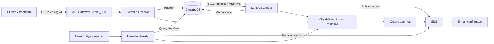

# Tech Challenge — Fase 4


Projeto desenvolvido para o **Tech Challenge da Fase 4 da Pós-Tech FIAP em Arquitetura e Desenvolvimento Java**.

A aplicação recebe avaliações de aulas, identifica situações críticas e entrega relatórios semanais por e-mail. A solução utiliza **Java 21, AWS Lambda, API Gateway, DynamoDB, SNS e EventBridge**, com infraestrutura declarada em AWS SAM.

O processamento é orientado a eventos e dividido em três funções independentes. A aplicação foi implantada e validada funcionalmente na AWS; os resultados e limites dessa validação estão registrados em [Testes e validação](#testes-e-validação).

---

## Funcionalidades

- Recebimento de avaliações com descrição e nota inteira de 0 a 10.
- Classificação automática de urgência e persistência no DynamoDB.
- Notificação automática por e-mail para avaliações críticas.
- Relatório semanal com média, total, quantidade por dia e por urgência, além dos detalhes das avaliações.
- API autenticada, logs, métricas, alarmes e aviso de orçamento.

## Arquitetura



### Modelo serverless e escolha da AWS

AWS Lambda implementa **Function as a Service (FaaS)**: cada handler é executado em resposta a um evento, sem administrar servidores da aplicação. API Gateway, DynamoDB, SNS e EventBridge completam o fluxo com serviços gerenciados. IAM controla o acesso; CloudWatch fornece observabilidade.

A AWS foi escolhida pela integração entre HTTP, persistência, Streams e agendamento, e pela possibilidade de declarar esses componentes em um único template SAM. O modelo permite separar responsabilidades e escalar o processamento conforme a demanda. Java e AWS são escolhas do projeto, não exigências exclusivas do enunciado.

### Funções

- **Receive — `ReceiveHandler`:** recebe o evento HTTP, valida a entrada, classifica a urgência e persiste a avaliação. Não envia notificações diretamente.
- **Critical — `CriticalHandler`:** consome inserções críticas do Stream, verifica a marca de envio, publica o alerta SNS e registra `notificationSentAt`.
- **Weekly — `WeeklyHandler`:** consulta a semana anterior completa, calcula estatísticas e publica o relatório SNS. Não altera avaliações.

As funções compartilham um JAR, mas têm handlers, gatilhos, configurações e roles independentes. Não existe chamada direta entre elas. O SNS entrega alerta e relatório ao destinatário configurado por `AdminEmail`.

## Tecnologias

- **Java 21 e Maven:** compilação e empacotamento com Maven Shade.
- **AWS Lambda e API Gateway REST:** handlers Java e entrada HTTP autenticada.
- **DynamoDB e DynamoDB Streams:** armazenamento, índice semanal e eventos de inserção.
- **Amazon SNS e EventBridge:** notificações por e-mail e agenda semanal.
- **CloudWatch, AWS IAM e AWS Budgets:** logs, métricas, alarmes, permissões e aviso financeiro.
- **AWS SAM / CloudFormation e S3:** infraestrutura declarativa, changesets e armazenamento privado de artefatos.
- **AWS SDK for Java v2 e Jackson:** acesso aos serviços e tratamento de JSON.
- **JUnit Jupiter 5.11.4 e Mockito 5.14.2:** testes automatizados sem serviços AWS reais.
- **GitHub Actions:** CI com `mvn -B verify` e lint SAM, sem credenciais cloud.

A **implantação real utilizou SAM local com credenciais temporárias**, seguida da revisão e execução do changeset. Não foi executado deploy pelo GitHub Actions. OIDC não é pré-requisito deste procedimento.

### Estrutura do projeto

```text
.
├── .github/workflows/ci.yml
├── .gitignore
├── README.md
├── pom.xml
├── template.yaml
├── scripts/verify.sh
├── postman/Tech-Challenge-Fase4.postman_collection.json
└── src/
    ├── main/java/br/com/fiap/feedback/
    │   ├── domain/          # Avaliação, urgência e contratos
    │   ├── handlers/        # Receive, Critical e Weekly
    │   └── infrastructure/  # Adaptadores DynamoDB/SNS e clientes AWS
    └── test/java/br/com/fiap/feedback/FlowsTest.java
```

## API e regras de negócio

```http
POST /v1/avaliacao
Content-Type: application/json
```

```json
{
  "descricao": "A aula precisa de mais exemplos práticos sobre eventos",
  "nota": 2
}
```

A rota é a equivalência técnica sem acento de `POST /avaliação`, referência do enunciado. `/v1` é o stage do API Gateway; não há alias acentuado. As [restrições de caminhos do gateway](https://docs.aws.amazon.com/apigateway/latest/developerguide/api-gateway-known-issues.html) motivam essa adaptação.

A descrição deve ser texto não vazio, de até 2.000 caracteres; espaços nas extremidades são removidos antes de persistir. A nota deve ser um número JSON **inteiro** entre 0 e 10. Decimais, inclusive `3.0`, strings, nulos e valores fora da faixa são rejeitados. Campos adicionais são ignorados.

Classificação adotada pelo projeto:

- **0–3:** `CRITICA`.
- **4–6:** `MEDIA`.
- **7–10:** `BAIXA`.

Respostas relevantes:

| HTTP | Situação |
|---|---|
| 201 | Avaliação persistida; retorna `id`, `urgencia` e `createdAt` |
| 400 | JSON ou campos inválidos |
| 403 | Requisição anônima ou não autorizada pelo gateway |
| 413 | Corpo decodificado acima de 16.000 caracteres, limite do handler |
| 503 | Falha de persistência tratada pelo handler |

`createdAt` é ISO-8601 em UTC, com precisão de milissegundos. Cada POST válido cria um novo ID; repetir a chamada não é uma operação idempotente.

A API usa **AWS_IAM**, com assinatura **SigV4**, região da API e serviço `execute-api`. Uma identidade temporária precisa de `execute-api:Invoke` para a rota. O exemplo mínimo abaixo usa placeholders, que devem ser substituídos pelos recursos da própria conta:

```json
{
  "Version": "2012-10-17",
  "Statement": [{
    "Effect": "Allow",
    "Action": "execute-api:Invoke",
    "Resource": "arn:aws:execute-api:REGION:ACCOUNT_ID:API_ID/v1/POST/avaliacao"
  }]
}
```

A identidade de chamada não precisa de acesso direto ao banco ou de permissões de deploy. O exemplo de uso autenticado está em [Postman](#postman); nenhuma chave fixa é distribuída com o projeto.

## Persistência e processamento assíncrono

### Modelo de dados

A tabela usa `id` como chave primária e capacidade sob demanda (`PAY_PER_REQUEST`). Cada item contém `descricao`, `nota`, `urgencia` e `createdAt`, além de `week` e `sort` para o índice **ByWeek**. `week` representa a segunda-feira da semana UTC; `sort` combina timestamp e ID. `notificationSentAt` é incluído após a publicação do alerta crítico.

O relatório faz `Query` paginada nas semanas UTC sobrepostas ao período local, com filtro final de início inclusivo e fim exclusivo. Não utiliza `Scan`. O GSI tem consistência eventual; leituras imediatamente após uma inserção podem não refletir o item mais recente.

### Alertas críticos

O Stream `NEW_IMAGE` alimenta Critical por um event source mapping, filtrado para `INSERT` com urgência `CRITICA`. O handler repete essa verificação defensivamente. Atualizar a marca de envio não gera outro alerta.

Falhas individuais retornam `ReportBatchItemFailures`; o mapping também permite bisseção do lote. Uma marca já gravada evita nova publicação nas reentregas observadas pelo handler. Existe janela de duplicidade entre publicar no SNS e registrar a marca, inclusive sob concorrência: **não há garantia de entrega única**. O Stream mantém eventos por 24 horas; atrasos precisam de intervenção antes de sua expiração.

O alerta contém ID, descrição, urgência, data da avaliação e data de envio. Publicação aceita pelo SNS ou marca no banco não comprova recebimento do e-mail.

### Relatório semanal

A regra `cron(0 12 ? * MON *)` agenda Weekly para segunda-feira às 12h UTC. O relatório considera a semana anterior em `America/Sao_Paulo`: segunda 00h inclusive até segunda seguinte 00h exclusiva. `REPORT_ZONE` define o fuso no ambiente da função; alterações futuras de fuso exigem revisar também a expressão UTC.

O conteúdo inclui total, média, sete contagens diárias — inclusive zeros —, quantidades por urgência e ID, descrição, nota, urgência e data de cada avaliação. A data global de geração/envio é distinta de `createdAt`; avaliações não críticas não têm data de alerta. Semana vazia produz total e média zero.

O handler usa o horário original do evento nas tentativas subsequentes; sem `time`, usa o relógio atual. Relatórios grandes são divididos em partes de até aproximadamente 230 KB de conteúdo UTF-8. Falhas propagam erro e podem repetir partes já publicadas; a regra permite duas novas tentativas, dentro de 24 horas. A agregação usa memória, dimensionada para o volume demonstrado.

## Segurança

- **Entrada protegida:** HTTPS, AWS_IAM/SigV4, throttling de 5 requisições/s com burst 10 e tracing de payload desabilitado no gateway.
- **Roles independentes:** Receive permite `PutItem` na tabela; Weekly permite `Query` no índice e `Publish` no tópico. As duas mantêm a política básica de logs gerada pelo SAM.
- **Critical explícita:** confiança somente em `lambda.amazonaws.com`, sem nome fixo ou políticas gerenciadas amplas. Leitura do Stream, `GetItem`/`UpdateItem`, publicação SNS e escrita de logs ficam limitados aos recursos correspondentes. Apenas `ListStreams` usa `Resource: "*"`, por não aceitar escopo por recurso. O grupo de logs independente evita dependência circular entre role e função.
- **Proteção dos dados:** DynamoDB com criptografia em repouso e PITR; artefatos em S3 com SSE-S3/AES256 e bloqueio público. SDKs usam HTTPS. O tópico SNS não configura criptografia em repouso por chave KMS.
- **Credenciais temporárias:** fornecidas pelo runtime ou perfil local, sem chaves estáticas em Git/CI. Não registrar headers de autorização, tokens ou payloads. Usar descrições fictícias nas verificações, pois as avaliações críticas e os detalhes semanais seguem por e-mail.

A TopicPolicy autoriza CloudWatch a publicar somente com a conta de origem e os quatro ARNs de alarmes da stack. Isso não substitui a revisão das permissões efetivas e das políticas organizacionais da conta de implantação.

## Monitoramento

As três funções possuem CloudWatch Logs com retenção de **14 dias**. Receive e Weekly usam `/aws/lambda/<nome-fisico>`; Critical usa o grupo dedicado indicado em `LoggingConfig.LogGroup`. Logs START/END/REPORT e request IDs permitem correlacionar execuções sem expor o corpo das avaliações.

Métricas relevantes: **Invocations, Errors, Duration, Throttles e IteratorAge**. Há quatro alarmes: Errors de Receive, Critical e Weekly — soma de pelo menos um erro em cinco minutos — e IteratorAge acima de 300.000 ms no consumidor do Stream. Dados ausentes são tratados como não violação. As ações enviam ao mesmo tópico SNS.

Um 503 tratado ou falha parcial de batch pode não incrementar Lambda Errors. Esses alarmes não cobrem todas as falhas de negócio; verificar também logs, respostas e estado do consumidor.

O Budget mensal é parametrizado por `MonthlyBudgetUSD` (padrão USD 5), com aviso acima de 80% do valor. Mede a conta inteira e **não bloqueia gastos**. Na última consulta da validação, o Free Plan estava FREE/ACTIVE, com créditos positivos e validade vigente. Isso não garante custo zero: DynamoDB/PITR, artefatos, logs e chamadas podem consumir créditos ou gerar custos conforme o plano. Conferir faturamento, validade dos créditos e recursos remanescentes; não aceitar upgrade automaticamente.

## Executando o projeto

### Pré-requisitos

Para compilar e testar: Git, **JDK 21 completo** e **Maven 3.9+**, com acesso ao Maven Central na primeira resolução. Instalar pelas instruções do [OpenJDK](https://jdk.java.net/archive/) e do [Maven](https://maven.apache.org/install.html), colocando `java` e `mvn` no PATH. Não são necessários AWS, Docker ou credenciais para os testes.

Para implantar: [AWS CLI v2](https://docs.aws.amazon.com/cli/latest/userguide/getting-started-install.html), [SAM CLI](https://docs.aws.amazon.com/serverless-application-model/latest/developerguide/install-sam-cli.html), cfn-lint para `sam validate --lint`, uma conta própria autorizada e destinatário de e-mail controlado pelo responsável. Postman é usado nos exemplos de chamadas autenticadas. Python 3.9+ com dados de fuso é opcional para calcular a data do teste semanal.

Os comandos abaixo usam **Bash** em Linux, WSL ou macOS. São instruções para execução na conta do responsável; criação, upload, changeset, invocação e exclusão alteram recursos ou consomem serviços.

### Clonar, compilar e testar

```bash
git clone https://github.com/pedrovpcs/tech-challenge-fase4.git feedback-aulas
cd feedback-aulas
java -version
mvn -version
mvn -B verify
```

`verify` compila, executa os testes e gera o JAR com dependências em `target/feedback-1.0.0.jar`; Surefire grava relatórios em `target/surefire-reports/`. Os testes usam dependências simuladas, sem chamadas AWS. É possível executar apenas a suíte com `mvn -B test`.

Validação adicional de infraestrutura e script consolidado, se SAM/cfn-lint estiverem instalados:

```bash
sam validate --lint --region "${AWS_REGION:-us-east-2}"
# Alternativa que reúne Maven verify e lint:
sh scripts/verify.sh
```

Não existe servidor HTTP local para iniciar com `java -jar`: o pacote contém handlers de eventos. O template referencia diretamente o JAR Maven; não é necessário executar `sam build` adicional.

### Perfil temporário e parâmetros próprios

```bash
REGION="${AWS_REGION:-us-east-2}"
PROFILE="feedback-sam"
STACK="feedback-demo"
BUCKET="SUBSTITUA-POR-NOME-GLOBALMENTE-UNICO-MINUSCULO"
BUDGET_USD="5"
```

Autenticar pelo mecanismo autorizado na própria conta. Para contas que suportam `aws login`, utilizar CLI **2.32.0+**:

```bash
aws login --profile feedback-login --region "$REGION"
```

Se o SAM não resolver diretamente a sessão de login, acrescentar um perfil a `~/.aws/config`, sem sobrescrever os existentes:

```ini
[profile feedback-sam]
region = us-east-2
credential_process = aws configure export-credentials --profile feedback-login --format process
```

Adaptar a região. `credential_process` entrega as credenciais à ferramenta; não executar `export-credentials` isoladamente em terminal capturado. Como alternativa, usar um perfil SSO temporário já autorizado e definir `PROFILE` para ele. [Autenticação oficial](https://docs.aws.amazon.com/cli/latest/userguide/cli-configure-sign-in.html).

```bash
aws sts get-caller-identity --profile "$PROFILE" --region "$REGION"
# Para contas da nova modalidade Free Plan, se a consulta estiver autorizada:
aws freetier get-account-plan-state --profile "$PROFILE" --region "$REGION" \
  --query '{Plano:accountPlanType,Estado:accountPlanStatus,Creditos:accountPlanRemainingCredits,Expira:accountPlanExpirationDate}'
```

Conferir a identidade e os dados financeiros localmente, sem publicar a saída. A identidade de implantação precisa de CloudFormation, S3 e ações necessárias aos recursos do template, incluindo criar/passar somente as roles da aplicação. `CAPABILITY_IAM` reconhece a criação de IAM, mas não concede acesso. Não é exigido usar AdministratorAccess; políticas organizacionais, quotas e disponibilidade regional podem bloquear o provisionamento. Não há verificação read-only universal que garanta permissão para todo o deploy.

### Bucket privado de artefatos

Usar um bucket **dedicado**, próprio e na mesma região, ou criar um novo após revisar plano e custos. Não reutilizar recursos compartilhados sem controle de escopo. Para um bucket novo:

```bash
if [ "$REGION" = "us-east-1" ]; then
  aws s3api create-bucket --bucket "$BUCKET" --profile "$PROFILE" --region "$REGION"
else
  aws s3api create-bucket --bucket "$BUCKET" --profile "$PROFILE" --region "$REGION" \
    --create-bucket-configuration "LocationConstraint=$REGION"
fi
aws s3api put-public-access-block --bucket "$BUCKET" --profile "$PROFILE" --region "$REGION" \
  --public-access-block-configuration 'BlockPublicAcls=true,IgnorePublicAcls=true,BlockPublicPolicy=true,RestrictPublicBuckets=true'
aws s3api put-bucket-encryption --bucket "$BUCKET" --profile "$PROFILE" --region "$REGION" \
  --server-side-encryption-configuration '{"Rules":[{"ApplyServerSideEncryptionByDefault":{"SSEAlgorithm":"AES256"}}]}'
```

Não habilitar versionamento ou Object Lock nesse bucket de demonstração; um bucket novo preserva ambos desabilitados. Conferir bloqueio público, criptografia, região, versão e ausência de Object Lock com as consultas `get-public-access-block`, `get-bucket-encryption`, `get-bucket-location`, `get-bucket-versioning` e `get-object-lock-configuration` do `s3api`. Ausência de configuração de Object Lock é esperada; AccessDenied não é confirmação de ausência. Não configurar política pública.

### AdminEmail e changeset

`AdminEmail` é obrigatório e define o destinatário SNS e do aviso de orçamento, sem alterar Java. Solicitar o valor no próprio terminal:

```bash
set +x
read -r -s -p 'E-mail administrativo para SNS e Budget: ' ADMIN_EMAIL
printf '\n'
sam deploy --template-file template.yaml --profile "$PROFILE" --region "$REGION" \
  --stack-name "$STACK" --s3-bucket "$BUCKET" --s3-prefix "$STACK" \
  --capabilities CAPABILITY_IAM \
  --parameter-overrides "AdminEmail=$ADMIN_EMAIL" "MonthlyBudgetUSD=$BUDGET_USD" \
  --no-execute-changeset
unset ADMIN_EMAIL
```

`NoEcho` protege a exibição do parâmetro no CloudFormation, sem garantir sigilo em argumentos locais, saídas SAM ou logs. Não habilitar debug, capturar o terminal ou salvar configurações com o endereço.

A preparação **já envia artefatos ao S3 e cria um changeset**, possivelmente com stack em REVIEW_IN_PROGRESS. Não é um dry-run sem escrita. Copiar o ARN completo retornado, revisar o template processado e os recursos/permissões:

```bash
CHANGESET="ARN_DO_CHANGESET_DA_SUA_CONTA"
aws cloudformation describe-change-set --change-set-name "$CHANGESET" --profile "$PROFILE" --region "$REGION"
aws cloudformation get-template --stack-name "$STACK" --change-set-name "$CHANGESET" \
  --template-stage Processed --profile "$PROFILE" --region "$REGION"
```

Na primeira criação com este template, a transformação prevê 24 recursos, incluindo três funções/roles, tabela/índice/Stream, API, SNS, agenda, logs, alarmes e Budget; o bucket é externo. Validar a relação concreta antes de executar. `DescribeChangeSet` não retorna `ChangeSetType`; para criação, correlacionar stack nova em REVIEW_IN_PROGRESS, changeset CREATE_COMPLETE/AVAILABLE, StackId e ações Add.

Depois da revisão e autorização dos custos na própria conta, executar **o changeset existente**:

```bash
aws cloudformation execute-change-set --change-set-name "$CHANGESET" --profile "$PROFILE" --region "$REGION"
aws cloudformation wait stack-create-complete --stack-name "$STACK" --profile "$PROFILE" --region "$REGION"
```

Para atualizações, usar a espera `stack-update-complete`. Em falha ou AccessDenied, consultar eventos e inventário antes de qualquer nova tentativa; não ampliar IAM automaticamente nem recriar recursos em sequência. [Comando SAM deploy](https://docs.aws.amazon.com/serverless-application-model/latest/developerguide/sam-cli-command-reference-sam-deploy.html).

### Descoberta dos recursos e assinatura SNS

```bash
aws cloudformation describe-stacks --stack-name "$STACK" --profile "$PROFILE" --region "$REGION" \
  --query 'Stacks[0].{Estado:StackStatus,Outputs:Outputs}'
aws cloudformation list-stack-resources --stack-name "$STACK" --profile "$PROFILE" --region "$REGION" \
  --query 'StackResourceSummaries[].{Logico:LogicalResourceId,Tipo:ResourceType,Fisico:PhysicalResourceId,Estado:ResourceStatus}'
```

Definir localmente os valores **da sua implantação**, obtidos nessas consultas:

```bash
ENDPOINT="OUTPUT_ENDPOINT_DA_SUA_STACK"
TOPIC="OUTPUT_TOPICARN_DA_SUA_STACK"
TABLE="NOME_FISICO_DE_Evaluations"
WEEKLY="NOME_FISICO_DE_Weekly"
CRITICAL="NOME_FISICO_DE_Critical"
RULE="NOME_FISICO_DA_REGRA_SEMANAL"
ALARM="NOME_FISICO_DE_UM_DOS_QUATRO_ALARMES"
```

A regra é gerada a partir de `Weekly.Events.Monday`; localizar pelo tipo e target, sem presumir o nome físico. Abrir o e-mail enviado pelo SNS ao endereço informado em `AdminEmail` e confirmar a assinatura. Verificar um SubscriptionArn válido:

```bash
aws sns list-subscriptions-by-topic --topic-arn "$TOPIC" --profile "$PROFILE" --region "$REGION" \
  --query 'Subscriptions[].{Protocolo:Protocol,Assinatura:SubscriptionArn}'
```

`PendingConfirmation` não recebe mensagens. A mesma assinatura recebe alertas críticos, relatórios e ações de alarme. Conferir o recebimento real; não publicar destinatários ou links de confirmação/cancelamento. [Assinaturas SNS por e-mail](https://docs.aws.amazon.com/sns/latest/dg/sns-email-notifications.html).

### Exercitar os três fluxos

1. **Recepção:** usar a collection Postman para uma chamada anônima (403), três assinadas com notas 2/5/8 (201) e uma decimal 3.5 (400). Anotar os IDs, sem repetir envios válidos desnecessariamente.
2. **Alerta crítico:** aguardar o Stream e correlacionar o item de nota 2 com o e-mail recebido. Conferir descrição, urgência e datas; as notas 5/8 não devem receber `notificationSentAt`.
3. **Relatório:** aguardar a propagação do GSI. Para incluir dados da semana corrente sem esperar o agendamento, invocar Weekly com referência à próxima segunda-feira. Isso envia e-mail real e deve ser identificado como teste manual.

Consulta consistente de cada item:

```bash
aws dynamodb get-item --table-name "$TABLE" --key '{"id":{"S":"ID_DA_RESPOSTA"}}' \
  --consistent-read --profile "$PROFILE" --region "$REGION"
```

Calcular o evento de teste semanal, ou substituir manualmente `time` pela próxima segunda às 12h UTC:

```bash
REPORT_EVENT=$(python3 - <<'PY'
import datetime, json, zoneinfo
now = datetime.datetime.now(zoneinfo.ZoneInfo('America/Sao_Paulo'))
next_monday = now.date() + datetime.timedelta(days=7-now.weekday())
print(json.dumps({'time': str(next_monday) + 'T12:00:00Z'}))
PY
)
aws lambda invoke --function-name "$WEEKLY" --profile "$PROFILE" --region "$REGION" \
  --cli-binary-format raw-in-base64-out --payload "$REPORT_EVENT" /tmp/feedback-weekly-response.json
```

Conferir ausência de `FunctionError`, ler a resposta no arquivo local e verificar o e-mail. Com apenas as três notas 2/5/8 na mesma semana, esperar total 3, média 5.00, uma avaliação por urgência, três no dia de criação e zeros nos demais. Se houver outros registros, recalcular. Invocar com `{}` consulta a semana anterior real e pode excluir os itens recém-criados.

### Consultar logs, agenda e alarmes

```bash
aws lambda get-function-configuration --function-name "$CRITICAL" --profile "$PROFILE" --region "$REGION" \
  --query '{Estado:State,UltimaAtualizacao:LastUpdateStatus,Runtime:Runtime,Logs:LoggingConfig.LogGroup}'
aws lambda list-event-source-mappings --function-name "$CRITICAL" --profile "$PROFILE" --region "$REGION" \
  --query 'EventSourceMappings[].{Estado:State,Resultado:LastProcessingResult,Filtro:FilterCriteria}'
aws events describe-rule --name "$RULE" --profile "$PROFILE" --region "$REGION"
aws events list-targets-by-rule --rule "$RULE" --profile "$PROFILE" --region "$REGION"
aws cloudwatch describe-alarms --alarm-names "$ALARM" --profile "$PROFILE" --region "$REGION"
```

Para consultar os logs da Critical, definir `LOG_GROUP` com o valor de `LoggingConfig.LogGroup` e executar:

```bash
LOG_GROUP="GRUPO_DE_LOGS_DA_FUNCAO"
aws logs tail "$LOG_GROUP" --since 1h --profile "$PROFILE" --region "$REGION"
```

Repetir a inspeção de configuração/logs para as demais funções; observar Invocations/Errors/Duration/Throttles no CloudWatch e o Budget no console de custos. Não publicar saídas brutas com identificadores da conta.

### Remover os recursos após o uso

Operações destrutivas: executar somente após confirmar propriedade, exclusividade e autorização para perder os dados. Antes da exclusão, inventariar nomes físicos de tabela, grupos de logs, regra, mapping e assinatura. Parar novas chamadas, desabilitar a regra semanal e aguardar execuções em curso para evitar novos envios ou recriação de logs.

Cancelar a assinatura **confirmada** do tópico dedicado antes de remover a stack. O template declara Subscription inline, que merece inspeção própria na limpeza, conforme a [referência CloudFormation](https://docs.aws.amazon.com/AWSCloudFormation/latest/TemplateReference/aws-resource-sns-topic.html#cfn-sns-topic-subscription). Não usar `PendingConfirmation` como ARN; inscrições ainda não confirmadas têm tratamento de expiração no SNS.

```bash
SUBSCRIPTION="ARN_DA_ASSINATURA_CONFIRMADA_DA_SUA_STACK"
aws sns unsubscribe --subscription-arn "$SUBSCRIPTION" --profile "$PROFILE" --region "$REGION"
aws cloudformation delete-stack --stack-name "$STACK" --profile "$PROFILE" --region "$REGION"
aws cloudformation wait stack-delete-complete --stack-name "$STACK" --profile "$PROFILE" --region "$REGION"
```

**A tabela DynamoDB permanece:** o template usa `DeletionPolicy` e `UpdateReplacePolicy: Retain`. Confirmar seu nome físico antes de excluí-la manualmente. Para evitar backup de sistema decorrente de exclusão com PITR ativo, desativar PITR e aguardar `DISABLED` antes do `delete-table`:

```bash
aws dynamodb update-continuous-backups --table-name "$TABLE" --profile "$PROFILE" --region "$REGION" \
  --point-in-time-recovery-specification PointInTimeRecoveryEnabled=false
aws dynamodb describe-continuous-backups --table-name "$TABLE" --profile "$PROFILE" --region "$REGION" \
  --query 'ContinuousBackupsDescription.PointInTimeRecoveryDescription.PointInTimeRecoveryStatus'
# Prosseguir apenas depois de DISABLED e da confirmacao da tabela dedicada:
aws dynamodb delete-table --table-name "$TABLE" --profile "$PROFILE" --region "$REGION"
aws dynamodb wait table-not-exists --table-name "$TABLE" --profile "$PROFILE" --region "$REGION"
```

GSI e Stream acompanham a tabela. Se ela for excluída com PITR ativo, verificar a retenção do backup de sistema; não presumir eliminação imediata de todas as cópias. Backups on-demand, se criados, requerem remoção própria. Conferir também eventuais tabelas retidas por substituições anteriores.

O bucket é externo à stack. Para bucket exclusivo, não versionado, limpar somente o prefixo da aplicação e excluir o bucket **apenas se estiver vazio e dedicado**:

```bash
aws s3 rm "s3://$BUCKET/$STACK/" --recursive --profile "$PROFILE" --region "$REGION"
aws s3api delete-bucket --bucket "$BUCKET" --profile "$PROFILE" --region "$REGION"
```

Em bucket compartilhado, não executar `delete-bucket`. Versões, delete markers, multipart uploads ou objetos fora do prefixo exigem inventário próprio; `s3 rm` não os resolve integralmente. Conferir remoção das funções, roles, API, SNS/política/assinatura, agenda, mapping, logs, alarmes e Budget; resolver DELETE_FAILED, rollbacks ou órfãos. Encerrar sessões temporárias, apagar valores do Vault e acompanhar o faturamento, cuja contabilização pode ter atraso.

## Testes e validação

Resultados históricos, sem nova execução durante a consolidação documental:

- **Local:** 29 testes aprovados, zero falhas, erros ou ignorados. Cobertura de limites/tipos, urgências, persistência, falhas, reentrega marcada, filtros de evento, período/média/contagens e paginação do índice. Maven verify e lint SAM concluíram com sucesso.
- **CI:** build, testes e validação SAM aprovados no desenvolvimento. O workflow preservado não contém deploy ou credenciais AWS; não foi acionado novamente nesta preparação.
- **AWS em 12/11/2026, us-east-2:** stack CREATE_COMPLETE, 24 recursos concluídos e três Lambdas Java 21 Active/Successful, com roles independentes. O bucket de artefatos é externo à contagem.

| Fluxo real com dados fictícios | Resultado comprovado |
|---|---|
| API anônima | 403, bloqueada antes da Lambda |
| Notas 2/5/8 com SigV4 temporário | Três HTTP 201: CRITICA/MEDIA/BAIXA |
| Nota decimal 3.5 autenticada | HTTP 400, sem registro adicional |
| DynamoDB | Três itens conferidos por leitura consistente e Query do GSI |
| Alerta crítico | Uma execução automática pelo Stream; marca somente na nota 2; e-mail recebido e conteúdo conferido pelo responsável |
| Relatório semanal | E-mail recebido: total 3, média 5,00, uma por urgência, descrições e datas corretas |
| Logs/métricas | Receive 4, Critical 1, Weekly 1; zero erros nas amostras consultadas |

O relatório abrangeu **09/11/2026 a 15/11/2026**, com três avaliações em 12/11 e zero nos outros dias. Houve **uma invocação manual** com `time=2026-11-16T12:00:00Z`, simulando a referência temporal do fechamento. A regra EventBridge estava ENABLED e com target Weekly, mas **o disparo natural do cron não foi observado**.

Os quatro alarmes estavam OK, com ações habilitadas; **não houve teste de disparo ou de entrega de alarme**. Dados ausentes tratados como não violação também podem resultar em OK. A entrega dos dois e-mails funcionais foi confirmada visualmente pelo responsável; não foi inferida somente a partir de Publish SNS. Capturas brutas e registros operacionais não integram o repositório.

A amostra não é teste de carga, concorrência, reentrega real ou auditoria completa de segurança. O chamador usou a sessão temporária autorizada de implantação; a política mínima de invocação documentada não representa um onboarding de usuários comprovado. O ambiente implantado é um registro histórico, sem promessa de disponibilidade futura. A reprodução em outra conta foi revisada estaticamente; não foi executada uma segunda implantação independente.

## Postman

Importar [Tech-Challenge-Fase4.postman_collection.json](postman/Tech-Challenge-Fase4.postman_collection.json). A collection contém chamada anônima, notas 2/5/8 e nota decimal inválida.

1. Definir `endpoint` com o output Endpoint da própria stack, incluindo `/v1/avaliacao`, e `awsRegion` com a região utilizada.
2. Na autorização **AWS Signature**, usar serviço `execute-api` e adicionar a assinatura nos Request Headers.
3. Fornecer **Access Key, Secret Key e Session Token temporários**. A collection referencia Vault local: `tc4-access-key`, `tc4-secret-key` e `tc4-session-token`. São nomes de segredos, não valores distribuídos pelo projeto.
4. Manter No Auth somente na requisição que espera 403. As demais herdam a autorização da collection e enviam JSON com `Content-Type: application/json`.

Obter os três valores pelo mecanismo de sessão autorizado da própria conta, sem expô-los em capturas ou histórico. Se o Postman não resolver Vault nesses campos, preencher os valores temporários localmente sem salvá-los na collection exportada. Não sincronizar ou publicar segredos. Ocultar Authorization e X-Amz-Security-Token. [Documentação AWS Signature do Postman](https://learning.postman.com/docs/use/send-requests/authorization/aws-signature/).

Em 403 inesperado, conferir sessão/token, região, assinatura, URI e permissão de Invoke; não remover AWS_IAM nem ampliar acesso para facilitar chamadas.

## Decisões técnicas

- **Handlers diretos em Java:** o fluxo é orientado a eventos e não exige framework web ou servidor permanente. Um JAR reduz duplicação de dependências sem unificar permissões/gatilhos.
- **DynamoDB com ByWeek:** acesso por ID e consultas semanais sem Scan; capacidade sob demanda acompanha o uso, com a limitação explícita de consistência eventual.
- **Stream entre persistência e alerta:** Receive conclui a gravação sem depender do envio de e-mail. A marca reduz duplicidade, sem prometer exactly-once.
- **SNS e agendamento UTC:** um tópico com destinatário parametrizado atende alertas e relatórios; o fechamento semanal aplica o fuso local de forma explícita.
- **SAM local e CI separados:** infraestrutura reproduzível e changeset revisável, sem exigir integração OIDC ou credenciais estáticas no GitHub.
- **Retenção deliberada:** PITR e tabela Retain protegem dados, exigindo limpeza explícita para evitar recursos remanescentes e consumo após o uso.

## Autor

Pedro Santos
